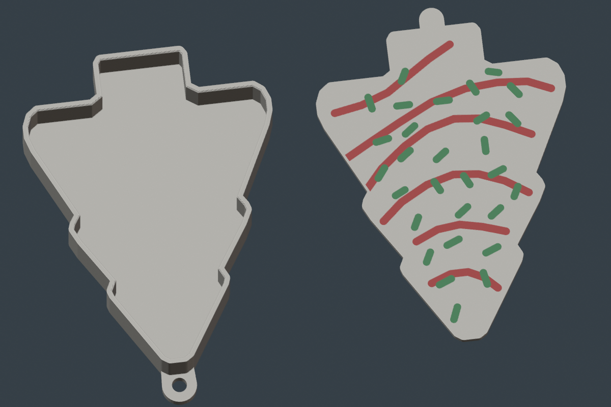

# Christmas Tree Case

A printable case for a wrapped tree-shaped snack, with a removable snap-fit lid, a pull tab at the trunk, and a 6 mm hole for a split ring. The lid has six red garlands and green sprinkles.

## Files

- [Tray STL](Tray.stl)
- [Three-color lid 3MF](Lid_Three_Color.3mf)
- [Single-color lid STL](Lid_Single_Color.stl)
- [Editable OpenSCAD model](Christmas_Tree_Case.scad)

The tray is 100 × 142.5 mm including the key-ring loop and 35.8 mm tall. With the lid fully seated, there is 30.0 mm of usable clearance from the interior floor to the lowest point of the lid rim (35.8 mm tray height minus the 2.4 mm floor and 3.4 mm lid intrusion). The closed case is 38.6 mm thick.

## Printing and assembly

Print the tray flat with the cavity up. Print either lid flat, with its exterior face on the bed and the locating rim up. Start with a 0.4 mm nozzle, 0.2 mm layers, and three perimeters. The parts are oriented for support-free printing.

Import the 3MF as a single multipart lid and assign ivory, red, and green filament to the corresponding parts. If your slicer does not retain the colors, assign the filaments manually. The color inserts occupy the first 0.6 mm of the lid.

Press the lid evenly into the tray until the two trunk detents seat. Lift the tab at the bottom to release it. The nominal clearance is 0.25 mm per side and can be edited in OpenSCAD. Meshes and seated fit were checked digitally. Snap force and printer-specific clearance have not been tested on a physical print.

## Three-color lid seating revision

A centered insertion sweep identified the trunk snap bumps as the only interference along the nominal insertion path. On the previous lid they contacted the tray wall about 2.08 mm before the flange seated. Each bump had to deflect inward by about 0.28 mm to pass the straight throat. The bump and recess centers were both 2.25 mm below the seating plane, and the rim had 30.00 mm of clearance above the tray floor. The modeled obstruction was therefore at the snap bumps, with no rim bottoming and no static interference in the fully seated position.

| Mating dimension | Previous three-color lid | Revised three-color lid |
| --- | ---: | ---: |
| Tray throat width at trunk | 33.60 mm | 33.60 mm |
| Rim width at trunk snaps, excluding bumps | 33.10 mm | 32.60 mm |
| Lateral clearance at each trunk rim flank | 0.25 mm | 0.50 mm |
| Width across snap crests | 34.15 mm | 33.90 mm |
| Required inward deflection per side at the throat | 0.28 mm | 0.15 mm |
| Snap crest depth below flange | 2.25 mm nominal | 1.69–1.85 mm |
| Tray recess center depth below upper edge | 2.25 mm | 2.25 mm |
| Centered lift before locking faces contact | 0.21 mm | 0.06 mm |
| Rim insertion depth | 3.40 mm | 3.40 mm |
| Usable interior clearance when fully seated | 30.00 mm | 30.00 mm |

The revised lid uses two relieved snap tabs with gradual insertion ramps and short locking faces that engage near the mouth of the existing recesses. The flange retains its seating surface. In the digital assembly it seats at a 0.00 mm seam with zero interference, and the tray, exterior envelope, and color parts retain their original geometry. Bambu Studio sliced the revised 3MF with all three colors. The measured lift and interference describe the centered digital model. Physical seam and retention force depend on the printed parts and have yet to be tested.
